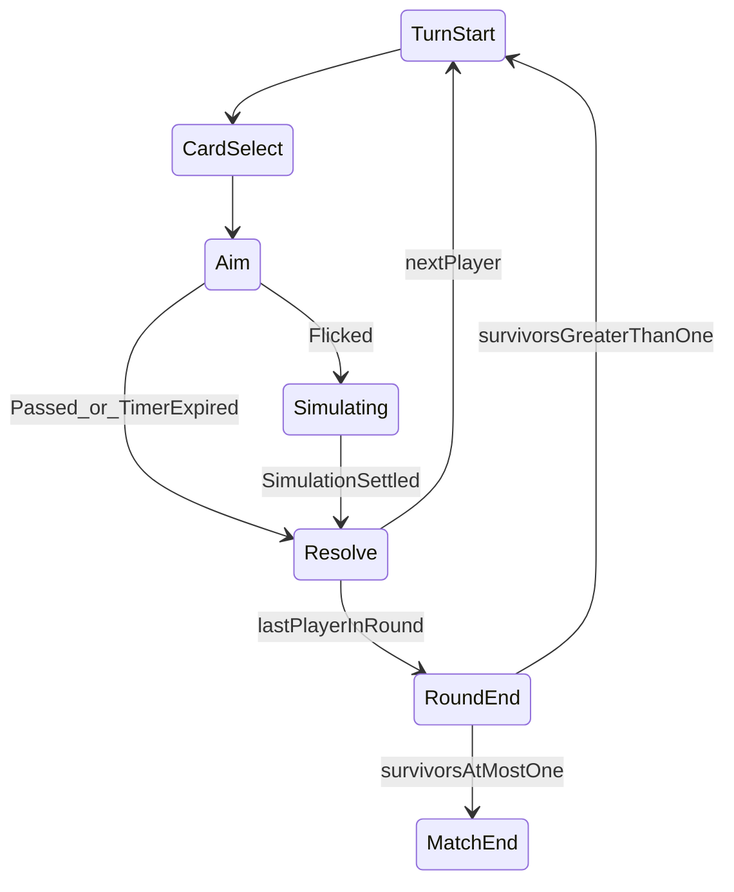

# 02 コアループ

## 1ターン

1. 手番が来る。自分の手番の始めにカードを1枚引く。落ちていたら、空いた定位置に戻る。
2. カードを出すか決める。出せるのは1ターン1枚で、弾く前だけ (Q54、Q55)。
3. 力点を決め、ドラッグして狙う。長く引くほど強く、ブレが大きく速い。
4. 離すと弾く。パスもできる。制限時間が切れると自動でパスになる。
5. 物理が止まるまで待つ。最大8秒で打ち切る。
6. 落ちた消しゴムのストックを1減らす。次の人へ手番を回す。

緊張は狙いの間にたまり、弾いた後の衝突と落下で解ける。
桜井の「ギュッとしてパッと解消」をこの1ターンに当てる ([sakurai.md](../research/sakurai.md))。

## 1ラウンド

全員が1手ずつ指すと1ラウンドが終わる。
勝敗はラウンドの終わりに判定する (Q18 の解釈)。
同じラウンドで落ちた者は同順位になる。
後攻に手番が残っていれば、試合は続く。

## 1試合

1. 人数とキャラを選び、デッキを確かめる。
2. 4か所の定位置にランダムで置く (Q27)。手札上限まで引く。
3. ラウンドを繰り返す。
4. 生き残りが1人以下になったラウンドの終わりで、試合が終わる。
5. 結果を出し、1ボタンで即再戦 (Q112)。

## 試合の外

- 試合で XP を得て、称号とキャラを解放する (Q51、Q82)。
- ストーリーとアドベンチャーでキャラを解放し、デッキを育てる ([08_modes.md](08_modes.md))。
- 図鑑はサブ要素 (Q85)。

## フェーズの遷移

試合の進行は `MatchReduce.Reduce(MatchState, MatchEvent)` だけが進める ([ADR-0005](../decisions/ADR-0005-reducer.md))。

イベントは `TurnStarted`、`CardPlayed`、`Flicked`、`Passed`、`EraserFell`、`SimulationSettled`、`TimerExpired`、`PlayerDisconnected`、`PlayerReconnected` の9種類。
